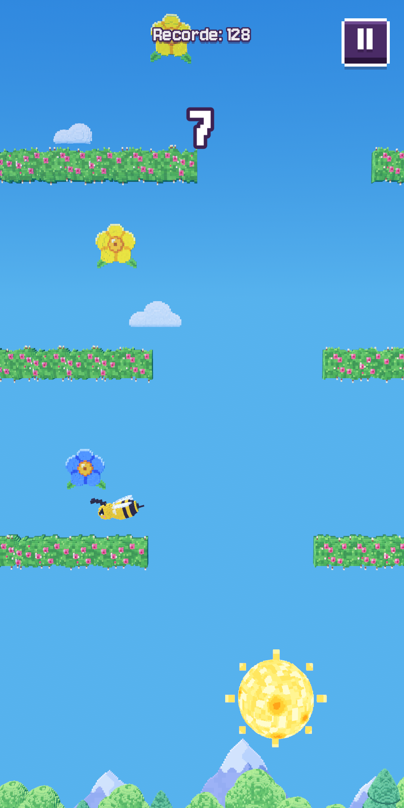
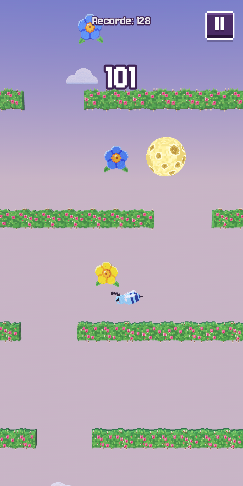

<p align="center">
  
  &nbsp;
  
</p>

<p align="center">
  <a href="https://beebee.cyberhat.com.br"><b>beebee.cyberhat.com.br</b></a>
</p>

# Bee Bee

Jogo de subir sem parar em voxel 3D, para Android e navegador. Com um toque à esquerda ou à direita, a abelha passa pelos buracos das roseiras e precisa pegar todas as flores do caminho: bateu na roseira ou deixou uma flor para trás, a partida acaba.

## O que tem

- Controle com um toque só: esquerda ou direita.
- Mundo todo em voxel, em 3D, com ciclo de dia e noite enquanto você sobe.
- Sete abelhas desbloqueáveis, cada uma ao chegar a uma pontuação.
- Interface em português e inglês.

## Tecnologias

| Parte | Tecnologia |
|---|---|
| Jogo | Godot 4.7 + GDScript |
| Modelos 3D em voxel | Blender (scripts em `tools/blender/`) |
| Ferramentas de build e arte | Python e shell (`tools/`) |
| Plataformas | Android e web |

## Como rodar

1. Instale o [Godot 4.7](https://godotengine.org/download/).
2. Abra esta pasta no Godot (`project.godot`) e aperte F5. A cena principal é `scenes/main.tscn`.

Os testes de comportamento rodam sem janela:

```bash
GODOT=/caminho/para/godot bash tools/test.sh
```

## Pastas

- `scripts/`, `scenes/`, `autoload/`: código e cenas do jogo
- `models/`, `art/`, `audio/`, `fonts/`: recursos
- `tools/`: testes, build e geração de arte
- `site/`: página do jogo
- `store/`: material da ficha na loja

---

Feito por [Vinícius Costa Magalhães](https://portfolio.cyberhat.com.br) · [Cyberhat](https://cyberhat.com.br)
